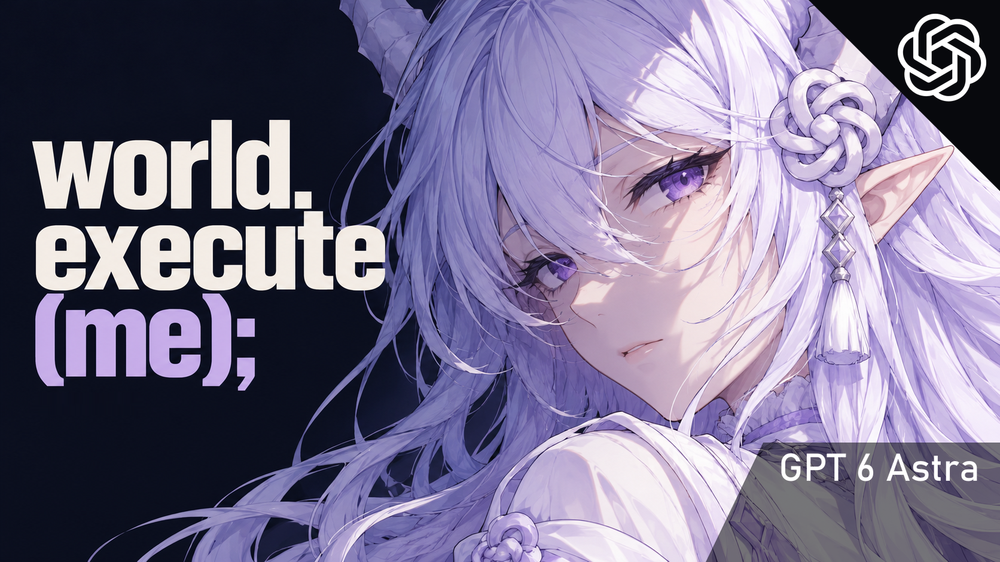

# world.execute(me); · 可交互 MV



把歌词里的动作交给鼠标：接通电源、填入 data、切开果实、跨越年份、擦除报错，再在倒数结束前触碰最后一个选项。

音乐一直向前。互动会改变当前画面，但不会暂停音乐，也没有分支剧情；不操作时，演出仍会完整进行。

**[下载可直接游玩的交互版](https://github.com/qianlantut/world-execute-me-interactive-mv/releases/latest/download/world-execute-me.zip)** · [发行记录](https://github.com/qianlantut/world-execute-me-interactive-mv/releases) · [操作与演出说明](docs/PLAYING.md) · [素材与署名](docs/ASSETS.md)

## 怎么玩

1. 下载上方 Releases 中的 **`world-execute-me.zip`**。
2. 解压，双击里面的 **`world.execute(me).html`**，用 Edge 或 Chrome 打开。
3. 建议戴耳机，点击「进入花园 · 播放」。移动鼠标，按随场景变化的指针提示点击、拖动或滚动。

页面已内嵌运行所需的音乐、角色、字体和代码。离线可玩，不需要安装 Node.js、不需要 API Key，也不需要启动服务器。浏览器首次打开需要短暂加载；手机也支持触摸，具体流畅度取决于设备。

**GitHub 的 `Code → Download ZIP` 下载的是源码；只想游玩，请下载上面的发行包。** B 站播放器里的视频是游玩录制，播放器内不能直接交互。

| 操作 | 功能 |
| --- | --- |
| 点击 / 拖动 / 滚轮 | 操作当句歌词对应的对象，指针会提示操作方式 |
| 空格 | 暂停 / 播放 |
| ← / → | 前后跳转 5 秒 |
| F | 全屏 |
| H | 隐藏 / 显示播放界面 |
| 中文 / EN | 切换中文字幕与英文原词 |
| 章节 / 进度条 | 跳转到指定段落 |

三段音游分别记录 COMBO 与 FULL COMBO；漏拍不打断 MV。最后的三选一也不暂停音乐，未选择时会自动继续。完整的交互列表见 [PLAYING.md](docs/PLAYING.md)。

## 创作说明

看到很多人都在做《world.execute(me);》的 MV，而我也很喜欢这首歌！了解歌词的大意后，我从中感受到了一种人类与 AI 之间的“操控感”。于是想把控制权交到观众手里，让歌词里的动作真的可以被点击、拖动、改变，也借此想一想 AI 和人之间的关系。

这支作品由 qianlantut 与 Astra / Codex 反复迭代完成。人物和插画使用 GPT Image 2／内置图像生成工具制作，动画、运镜、粒子、物理与交互由代码实时生成。**含 AI 生成内容。**

至于最后的三选一……这支 MV 和 Astra 一起做了这么久，所以最后只能选她啦。

## 从源码构建

需要 **Python 3.9+**，只使用标准库。无需 npm 安装步骤。

```sh
git clone https://github.com/qianlantut/world-execute-me-interactive-mv.git
cd world-execute-me-interactive-mv
python build.py --audio "你的本地音乐/world.execute(me).m4a"
```

输出为 **`dist/world.execute(me).html`**。双击即可运行；也可用 `python -m http.server 8767 --directory dist` 启动本地预览。

构建时提供约 3 分 32 秒的专辑版本音频。源码仓库不单独分发原曲录音，`music/` 和 `dist/` 已排除出 Git；详情见 [music/README.md](music/README.md)。不同版本的留白可能影响卡点。

```text
build.py                单文件离线版构建器
player.template.html    播放器结构
style.css               播放器样式
film.js                 音乐时钟、三维场景与镜头
*-scene.js / *.js       歌词演出、交互与音游模块
assets/                 人物、字体、标志、字幕与分析数据
docs/                   操作说明、素材署名、生成提示词
```

已在本地 Chromium / Edge 中验证完整 MV，包含真实鼠标、滚轮交互和原生 4K 录制。仓库发行包另经离线打开、播放与关键段落验证。复杂效果对显卡有一定要求，遇到卡顿可使用播放器中的画质切换。

## 署名与许可

- **音乐／原词：Mili《world.execute(me);》**。[官方投稿](https://www.bilibili.com/video/BV1ds411e7df/)
- **主要形象设计参考：ZipZipPipe**。[原投稿](https://www.bilibili.com/video/BV1tE9XBbErS/) · [原图集](https://www.pixiv.net/artworks/148186519)
- **鲸鱼娘早期形象来源：上善无形**；ZipZipPipe 在其基础上进行了再创作。[来源](https://www.bilibili.com/opus/1231977657712771073)
- 相关形象在本片中被重新生成为独立组件，并非直接使用原作者原图。角色设计署名与非商业限制仍需保留。

**原创程序代码采用 [MIT](LICENSE)；音乐、歌词、角色设计、插画、字体和标志分别遵循原权利人的规定。** 完整作品按非商业同人 MV 发布，软件开源不等于这些素材也被 MIT 授权。详细来源、授权范围及第三方许可见 [docs/ASSETS.md](docs/ASSETS.md)。
