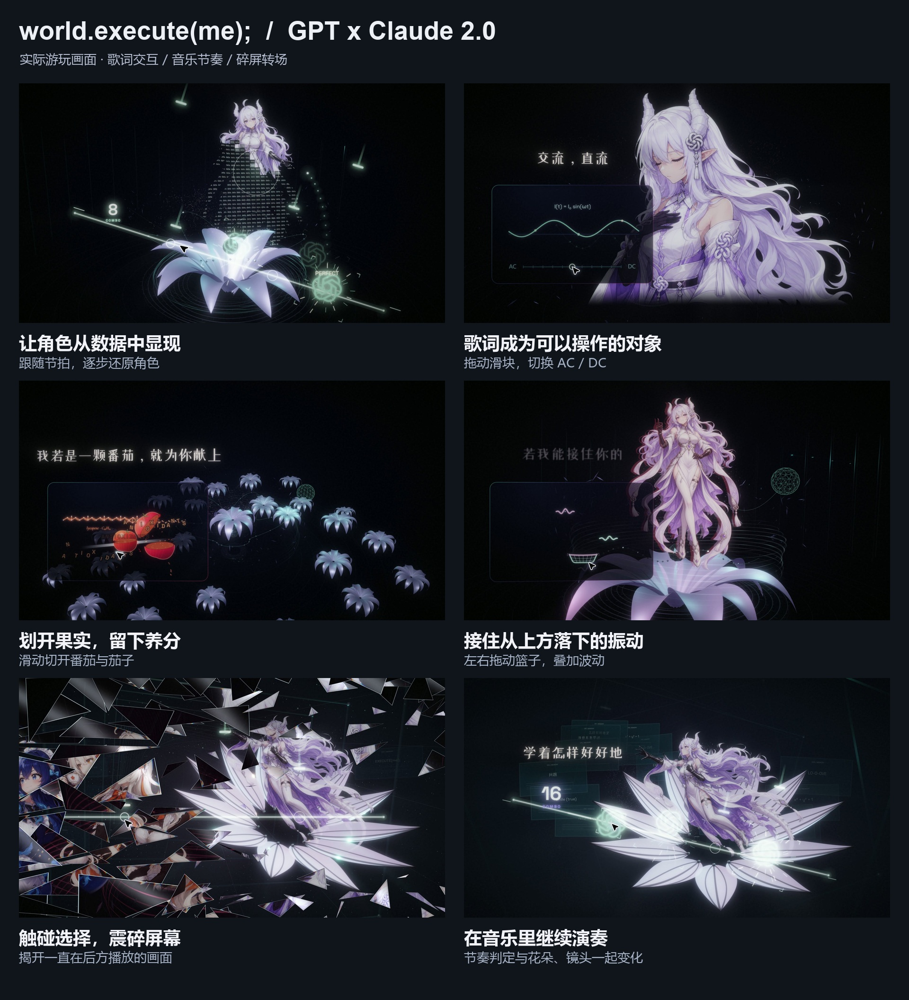

# world.execute(me); · GPT × Claude 2.0


《world.execute(me);》可交互 HTML MV 的 2.0 合作版。Astra 搭建原版的演出与交互，Claude 参与新版美术优化，浅蓝负责创作方向、体验与多轮修改。

**[下载 2.0 离线游玩包](https://github.com/qianlantut/world-execute-me-interactive-mv/releases/download/v2.0.0/world-execute-me-v2.0.0.zip)** · [2.0 发行页](https://github.com/qianlantut/world-execute-me-interactive-mv/releases/tag/v2.0.0) · [保留的 1.0](https://github.com/qianlantut/world-execute-me-interactive-mv/releases/tag/v1.0.0)

## 怎么玩

下载并解压 `world-execute-me-v2.0.0.zip`，用 Edge / Chrome 打开 `world.execute(me)-v2.html`，等待资源加载后点击开始。无需服务器、Node.js 或 API Key，建议戴耳机。

音乐持续前进。点击、拖动和滚轮会影响当前画面的演出，不操作也能完整观看；没有分支剧情。三段音游记录 COMBO / FULL COMBO，漏拍不会中断 MV。

空格暂停；← / → 跳转五秒；F 全屏；H 显示或隐藏界面。播放器支持中英文歌词、章节跳转和画质切换。触摸操作与流畅度取决于设备，桌面浏览器体验优先。

## 这一版

- 调整角色、花朵与后段空间的构图和层次，让花瓣逐步托住、包裹角色，再以花脉形成束缚。
- 重做 Bloom 与抗锯齿，减少文字和角色周围的重复光影与杂点。
- 强化歌词的逐字入场、开场关键词收束、音游命中和 FULL COMBO 反馈。
- 调整角色故障效果、裂纹扩散与碎屏释放，让隐藏在前景后面的演出连续出现。
- 保留歌词驱动的电源、data、AC/DC、年份、果实、昼夜、振动与擦除等互动。



完整玩法见 [PLAYING.md](docs/PLAYING.md)，更新摘要见 [CHANGELOG.md](CHANGELOG.md)。预览截图来自 2.0 的实际游玩录制；仓库和发行包均不包含 MP4 视频。

## 从源码构建

需要 Python 3.9+，只使用标准库。在仓库根目录执行：

```sh
python v2/build.py --audio "你的本地音乐/world.execute(me).m4a"
```

输出 `v2/dist/world.execute(me)-v2.html`。也可以通过 `--output` 指定输出文件。源码包解压后，在其根目录执行 `python build.py --audio "歌曲路径"`。

源码不提交独立歌曲文件；请使用约 3 分 32 秒的专辑版本，否则歌词卡点可能不同。`assets/` 中保留运行所需的图像、字体、标志和时序数据。

## 署名与许可

音乐／原词：Mili《world.execute(me);》。主要形象设计参考：ZipZipPipe；鲸鱼娘早期形象来源：上善无形，ZipZipPipe 在此基础上再创作。人物插画依据这些设计通过 GPT Image 2 重新生成。含 AI 生成内容。

原创程序代码采用 [MIT](LICENSE)；音乐、歌词、角色设计、插画、字体及标志按各自许可使用。完整作品为非商业同人 MV；代码开源不代表其他素材也按 MIT 授权。详细出处和限制见 [素材与署名](docs/ASSETS.md)。

仓库根目录保留 1.0 源码；`v2/` 是独立的 2.0 源码。两个版本可以分别构建。
